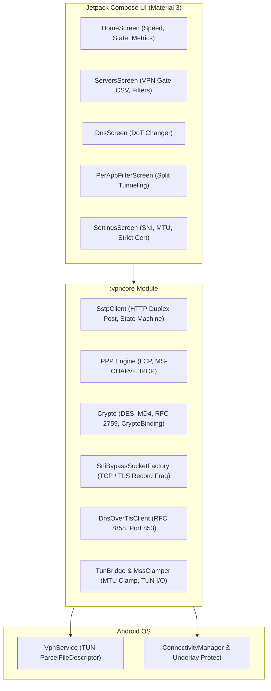

# Aether VPN — Native Android SSTP Client & VPN Gate Browser

A native Android VPN client app written in modern Kotlin, Jetpack Compose, and Material 3. Features full userspace MS-SSTP implementation, public VPN Gate server browsing, DNS-over-TLS (DoT) changer, split-tunnel per-app filtering, and automatic SNI-blocking bypass.

## Architecture



## Features

- **Userspace MS-SSTP Engine**: Full client implementation of `[MS-SSTP]` specification on top of Android's `VpnService`:
  - `SSTP_DUPLEX_POST` handshake over TLS (port 443).
  - LCP negotiation (MRU clamping, Magic Number, MS-CHAPv2 negotiation).
  - Strict RFC 2759 MS-CHAPv2 mutual authentication.
  - Crypto Binding attribute computation (Compound MAC derived from MS-CHAPv2 master keys, leaf certificate SHA-256 and SHA-1 verification).
  - IPCP network configuration (IP address and DNS assignment).
  - TCP MSS clamping to eliminate fragmentation blackholes.
- **VPN Gate Public Server Browser**:
  - Live parser for VPN Gate's public server directory (`https://www.vpngate.net/api/iphone/`).
  - Search, sort by score, speed, ping, and uptime.
  - Country filtering and favorites.
  - Custom user server entry (host, port, username, password, custom SNI).
  - Offline bundled fallback snapshot and user-configurable mirror URLs.
- **SNI-Blocking Bypass (Auto-Fallback)**:
  - Direct connection by IP without SNI.
  - TCP ClientHello segmentation (splits SNI field across TCP segments with micro-delays).
  - TLS record layer fragmentation (splits handshake payload across multiple TLS records).
  - Custom/Fake SNI support.
- **DNS-over-TLS Changer (No Root)**:
  - TUN packet interception for DNS (port 53) forwarded to DoT (port 853).
  - Presets for Cloudflare, Google Public DNS, Quad9, AdGuard, OpenDNS, CleanBrowsing, and Yandex.
  - Dedicated "DNS-Only" mode without routing general traffic through the tunnel.
- **Split Tunneling (Per-App Filter)**:
  - "All apps use VPN", "Only selected apps use VPN" (`addAllowedApplication`), "All except selected" (`addDisallowedApplication`).
  - Searchable installed app list with system app toggle.
- **Zero Trackers / Privacy First**:
  - No ads, no third-party analytics, no logging libraries.
  - Password redaction in connection logs.
  - Full English and Persian (fa) localization from day one.

## Project Structure

```
├── app/
│   ├── src/main/java/com/aethervpn/client/
│   │   ├── data/
│   │   │   ├── datastore/ (UserSettings, PreferencesManager)
│   │   │   ├── local/ (Room AppDatabase, VpnServerDao)
│   │   │   ├── model/ (VpnServer)
│   │   │   ├── repository/ (ServerRepository)
│   │   │   └── source/ (VpnGateCsvParser)
│   │   ├── di/ (Hilt AppModule)
│   │   ├── service/ (AetherVpnService, VpnStateHolder, AetherTileService, BootReceiver)
│   │   └── ui/ (MainActivity, MainViewModel, screens/, theme/)
│   └── src/main/res/ (values/, values-fa/ for Persian localization)
├── vpncore/
│   ├── src/main/java/com/aethervpn/vpncore/
│   │   ├── crypto/ (Des, Md4, MsChapV2, CryptoBinding)
│   │   ├── dns/ (DnsOverTlsClient, DnsResolver)
│   │   ├── ppp/ (PppFrame, Lcp, Ipcp, ChapPacket)
│   │   ├── sstp/ (SstpPacket, SstpClient, SstpConfig)
│   │   ├── transport/ (SniBypassSocketFactory, SniStrategy, SocketProtector)
│   │   └── tun/ (MssClamper)
│   └── src/test/ (RFC 2759 test vectors, SSTP, PPP, CryptoBinding, DoT unit tests)
├── docker/ (Local SoftEther SSTP test harness)
└── docs/ (PROTOCOL_NOTES.md)
```

## Building & Testing

### Requirements
- JDK 17
- Android SDK 35 (minSdk 24)

### Build Debug APK
```bash
./gradlew assembleDebug
```

### Run Unit Tests
```bash
./gradlew test
```

### Run Local Integration Server
```bash
cd docker
docker-compose up -d
```
Connect using host `10.0.2.2`, port `443`, username `vpn`, password `vpn`.
