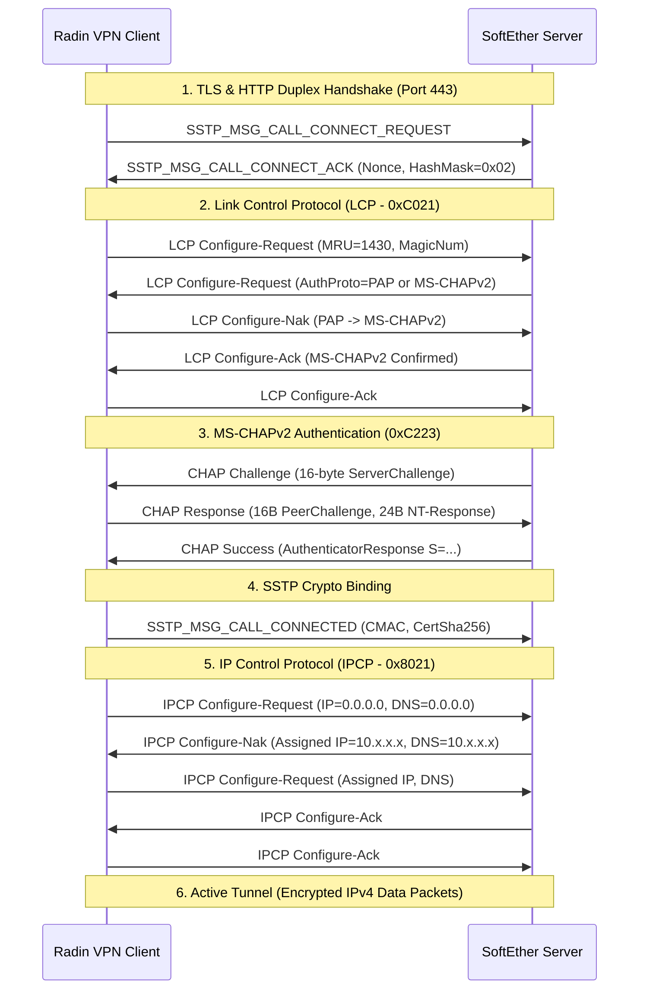

# Radin VPN (`رادین وی‌پی‌ان`) — Protocol Engineering & Technical Notes

This document provides in-depth protocol specifications, wire formats, timing constraints, and censorship evasion mechanics implemented in `:vpncore`.

---

## 1. MS-SSTP Architecture & Handshake Flow

MS-SSTP (Secure Socket Tunneling Protocol v1.0, `[MS-SSTP]`) encapsulates PPP frames over an encrypted TLS channel (typically TCP port 443).

### Step 1: HTTP Duplex Post Handshake
The client issues an HTTP POST request using the non-standard method `SSTP_DUPLEX_POST`:
```http
SSTP_DUPLEX_POST /sra_{BA195980-CD49-458b-9E23-C84EE0ADCD75}/ HTTP/1.1\r\n
SSTPCORRELATIONID: {<UUID>}\r\n
Content-Length: 18446744073709551615\r\n
Host: <hostname-or-ip>\r\n
\r\n
```
The server answers with `HTTP/1.1 200 OK`. Immediately following the CRLFCRLF (`\r\n\r\n`) header delimiter, both endpoints switch from HTTP formatting to raw binary SSTP packet framing.

### Step 2: SSTP Binary Packet Structure
```
 0                   1                   2                   3
 0 1 2 3 4 5 6 7 8 9 0 1 2 3 4 5 6 7 8 9 0 1 2 3 4 5 6 7 8 9 0 1
+-+-+-+-+-+-+-+-+-+-+-+-+-+-+-+-+-+-+-+-+-+-+-+-+-+-+-+-+-+-+-+-+
|    Version    |   Reserved  |C|            Length             |
+-+-+-+-+-+-+-+-+-+-+-+-+-+-+-+-+-+-+-+-+-+-+-+-+-+-+-+-+-+-+-+-+
|       Message Type            |       Num Attributes          |
+-+-+-+-+-+-+-+-+-+-+-+-+-+-+-+-+-+-+-+-+-+-+-+-+-+-+-+-+-+-+-+-+
```
- **Version (8 bits)**: `0x10` (SSTP v1.0).
- **Reserved (7 bits)**: Must be zero.
- **Control Flag (C, 1 bit)**: `0x01` for Control packets, `0x00` for Data packets.
- **Length (12 bits)**: Total length of the packet in bytes, including the 4-byte header.
- **Data Packets (`C = 0`)**: Encapsulate higher-layer PPP frames directly without Message Type or Attribute headers.
- **Control Packets (`C = 1`)**: Carry SSTP signaling messages:
  - `0x0001`: `SSTP_MSG_CALL_CONNECT_REQUEST`
  - `0x0002`: `SSTP_MSG_CALL_CONNECT_ACK`
  - `0x0003`: `SSTP_MSG_CALL_CONNECT_NAK`
  - `0x0004`: `SSTP_MSG_CALL_CONNECTED`
  - `0x0005`: `SSTP_MSG_CALL_DISCONNECT`
  - `0x0006`: `SSTP_MSG_CALL_DISCONNECT_ACK`
  - `0x0007`: `SSTP_MSG_ECHO_REQUEST`
  - `0x0008`: `SSTP_MSG_ECHO_RESPONSE`

---

## 2. Crypto Binding & Compound MAC Protection

SSTP incorporates Crypto Binding to protect against Man-in-the-Middle (MitM) attacks where an attacker terminates the outer TLS tunnel independently of the inner PPP credentials.

### Protocol Verification Sequence
1. Server supplies a 32-byte pseudo-random `Nonce` in `SSTP_MSG_CALL_CONNECT_ACK`, along with `HashProtocolMask` (`0x02` for SHA-256).
2. Client hashes the server's leaf X.509 certificate using SHA-256:
   $$\text{CertHash} = \text{SHA256}(\text{ServerCertificateDer})$$
3. Client derives the Compound MAC Key (CMK) from the 32-byte MS-CHAPv2 Master Key generated during phase 2:
   $$\text{CMK} = \text{HMAC\_SHA256}(\text{MasterKey}, \text{"SSTP inner method key derivation"})$$
4. Client constructs the `SSTP_MSG_CALL_CONNECTED` packet containing a 104-byte Crypto Binding attribute:
   - Attribute Header (4 bytes: Attribute ID `0x03`, Length `108`)
   - Reserved + Hash Protocol (4 bytes: `0x02` for SHA-256)
   - Nonce (32 bytes from server ACK)
   - Compound MAC placeholder (32 bytes of zeros)
   - Certificate Hash (32 bytes)
5. Client computes:
   $$\text{CompoundMac} = \text{HMAC\_SHA256}(\text{CMK}, \text{CallConnectedPacketBytes})$$
6. Client overwrites the 32-byte zero placeholder with the resulting Compound MAC digest and transmits the packet.
7. SoftEther's SSTP handler (`Proto_SSTP.c` line 253) verifies the packet format and transitions from `SSTP_SERVER_STATUS_CONNECTED_PENDING` to `SSTP_SERVER_STATUS_ESTABLISHED`.

---

## 3. PPP State Machine & Timing Constraints

The Point-to-Point Protocol (PPP) handles authentication and network layer configuration over SSTP Data Packets:



### Critical SoftEther Server Timing Constraints
- **1-Second PPP Timer Tick:** SoftEther VPN Server ticks its internal PPP timer every 1000 ms (`Proto_PPP.c`).
- **High-RTT Sensitivity:** When connecting from Iranian networks to Asian (Japan) or European servers, round-trip time (RTT) exceeds 600 ms. If a transport strategy clamps the TCP receive window or introduces artificial delay stalls (such as Zapret 28ms packet pacing), the round-trip latency of multi-turn PPP packets (e.g. `Configure-Request` -> `Configure-Nak` -> `Configure-Request` -> `Configure-Ack`) exceeds SoftEther's timer threshold.
- **Consequence of Window Clamping:** The server initiates LCP termination (`LCP Terminate-Request`) and drops the connection.
- **Design Principle for Radin VPN:** Never clamp the TCP receive window on high-RTT links. Allow the OS kernel to dynamically scale the TCP window (`tcp_rmem` auto-tuning) to ensure immediate ACK processing and zero retransmission stalls.

---

## 4. SNI Censorship Evasion Mechanics

Deep Packet Inspection (DPI) censorship middleboxes monitor the unencrypted `Server Name Indication` (SNI) extension inside the initial TLS `ClientHello` packet. Radin VPN defeats DPI through several complementary strategies:

1. **Direct IP / No SNI (`DIRECT_IP_NO_SNI` / `DISABLED`)**:
   - SoftEther servers bind SSTP to their public IP endpoint and do not require SNI.
   - Connecting directly without populating the SNI extension results in a completely clean ClientHello containing no domain for DPI filters to inspect, while avoiding any TCP stream manipulation.
2. **TLS Header Desync (`TLS_HEADER_DESYNC`)**:
   - The initial 5-byte TLS record header (`0x16 0x03 0x01 Length_Hi Length_Lo`) is split across separate TCP segments with a 2-byte initial chunk.
   - Stateful DPI middleboxes fail to recognize the TLS protocol handshake and pass the stream through without triggering SNI pattern matchers.
3. **Surgical Multi-Chunk SNI Splitting (`MULTI_CHUNK_FRAGMENTATION`)**:
   - `TlsClientHelloInspector` parses the raw ClientHello byte structure, finds the exact byte offset of the SNI extension, and splits the handshake record precisely across the SNI domain midpoint.
   - Evades middleboxes with small reassembly windows while allowing the destination server's standard TLS stack to reassemble the handshake.
4. **Decoy SNI (`DECOY_SNI_FRAGMENT`)**:
   - Wraps the connection with an initial benign or whitelisted domain before transitioning to the payload.

---

## 5. DNS over TLS (DoT) & DNS over HTTPS (DoH) Pipeline

1. The TUN interface intercepts outbound IPv4 UDP packets destined for port 53.
2. The packet payload (DNS wire format) is dispatched into a bounded 6-worker queue.
3. Queries are forwarded over RFC 7858 DoT (port 853) or RFC 8484 DoH (port 443) using persistent HTTP/2 pipelining:
   - Primary: Cloudflare (`1.1.1.1`), Google (`8.8.8.8`), Quad9 (`9.9.9.9`), AdGuard (`94.140.14.14`).
   - Responses are cached in `DnsResponseCache` with strict TTL compliance and LRU eviction.
4. In **Split DNS Mode**, Iranian domains (`.ir`) and domestic services are excluded from the tunnel and resolved natively through the physical network interface (`SocketProtector.protect()`), ensuring high speed and zero bank/tax portal blockages.

---

## 6. SoftEther Native Multi-TCP Protocol Engine (`Proto_VPN.c` / Cedar)

Radin VPN implements a pure userspace client for SoftEther's proprietary native protocol, delivering high throughput via multi-connection TCP bonding and Layer-2 Ethernet emulation over virtual switches.

### Step 1: Handshake Watermark Signature
Every TCP/TLS channel begins with an HTTP POST request targeting `/vpn/connect.cgi`:
```http
POST /vpn/connect.cgi HTTP/1.1\r\n
Host: <hostname-or-ip>\r\n
User-Agent: Mozilla/5.0 (Windows NT 10.0; Win64; x64) AppleWebKit/537.36\r\n
Content-Type: image/jpeg\r\n
Content-Length: 64\r\n
Connection: Keep-Alive\r\n
Keep-Alive: timeout=15, max=100\r\n
\r\n
<64-byte VPNCONNECT signature binary body>
```
The server verifies the `VPNCONNECT` magic signature and responds with `HTTP 200 OK` containing a serialized `SoftEtherPack` with a 20-byte pseudo-random server challenge (`random`).

### Step 2: SoftEther Pack Wire Format
SoftEther encodes all RPC messages in a binary Key-Value structure:
- **Element Count (4 bytes, Big-Endian)**: Total number of named elements in the pack.
- **For Each Element**:
  - Name Length (1 byte) + Name ASCII string (null-terminated).
  - Type (4 bytes):
    - `0`: Int (4-byte signed Big-Endian)
    - `1`: Data / Bytes (4-byte length + raw bytes)
    - `2`: String (4-byte length + ASCII string)
    - `3`: WideString / UTF-16
    - `4`: Int64 (8-byte signed Big-Endian)
  - Number of Values (4 bytes): Allows array properties.
  - Value data payloads.

### Step 3: Session Authentication (`method = "login"`)
The Primary Channel (Channel 0) issues a `POST /vpn/vpn.cgi` request containing an encoded `SoftEtherPack`:
- `method`: `"login"`
- `hubname`: Virtual Hub name (default: `"VPNGATE"`)
- `username`: Client username (default: `"vpn"`)
- `auth_type`: `1` (Password Authentication)
- `secure_password`: Derived password hash:
  $$\text{Hash} = \text{SHA0}(\text{MD4}(\text{password}) \mathbin{\Vert} \text{ServerRandomChallenge})$$
- `max_connection`: Target concurrent TCP channels requested by client (default: `2`).

The server responds with a welcome pack containing:
- `session_key`: 20-byte unique session identifier used by secondary channels.
- `max_connection`: Maximum bonded channels authorized by server policy.

### Step 4: Multi-TCP Secondary Channel Bonding (`method = "additional_connect"`)
To achieve bandwidth aggregation across multiple TCP connections, the client spawns secondary TCP/TLS connections concurrently:
- Each secondary channel connects to `/vpn/connect.cgi`, performs the watermark handshake, and posts an `additional_connect` pack:
  - `method`: `"additional_connect"`
  - `session_key`: The 20-byte session key granted to the primary channel.
- Once accepted (`HTTP 200 OK`), the secondary connection immediately switches from HTTP to the raw Ethernet frame multiplexer and shares the primary tunnel's Layer-2 virtual switch port.

### Step 5: Multiplexed Frame Transmission & Flow Hashing
On an established SoftEther channel, all data is exchanged as framed Ethernet blocks:
```
+-----------------------------------+
|  Num Frames in Block (4 bytes)    |  -> 0 = Cedar keepalive ping probe
+-----------------------------------+
|  Frame 1 Length (4 bytes)         |
+-----------------------------------+
|  Frame 1 Raw Ethernet II Data     |  -> 14-byte Eth Header + IP Payload
+-----------------------------------+
|  Frame 2 Length (4 bytes)         |
+-----------------------------------+
|  ...                              |
+-----------------------------------+
```
- **5-Tuple Flow Hashing**: To prevent TCP out-of-order segment arrival across bonded channels, outbound IP packets are routed using a 5-tuple hash:
  $$\text{Hash} = \text{FlowHash}(\text{srcIp}, \text{dstIp}, \text{protocol}, \text{srcPort}, \text{dstPort})$$
  $$\text{ChannelIndex} = (\text{Hash} \land \text{0x7FFFFFFF}) \pmod{\text{ActiveChannelsCount}}$$
  All packets belonging to the same TCP stream consistently travel over the same physical channel.

### Step 6: Virtual DHCP & RFC 826 ARP Protocol
- **Virtual DHCP**: SoftEther's Virtual NAT/SecureNAT engine functions as a full Layer-2 DHCP server:
  - Client generates a randomized MAC address with `0x00, 0xAC` OUI prefix.
  - Client broadcasts a DHCP `DISCOVER` frame encapsulated in Ethernet (`FF:FF:FF:FF:FF:FF`).
  - Includes **DHCP Option 61 (Client Identifier)** (`hwType=1, MAC`) to ensure compliance with strict Japanese and university networks.
  - Receives `OFFER`, broadcasts `REQUEST`, and captures `ACK` with assigned IP, gateway, netmask, and DNS servers.
- **RFC 826 ARP Engine**:
  - Outbound ARP discovery requests are padded to 60 bytes minimum Ethernet frame length.
  - The client automatically learns the Gateway MAC address from incoming IPv4 frames.
  - Inbound ARP requests for the client's assigned IP receive immediate 60-byte padded ARP replies.

### Step 7: Zero-Allocation Fast Path & Low-Latency Tuning
- **Zero-Allocation TX**: `sendIpPacketAsFrame()` formats the 14-byte Ethernet header and IP packet directly inside a reusable `ByteBuffer txBuffer` without creating temporary `ByteArray` heap objects.
- **Zero-Allocation RX**: `readLoop` delivers received frames directly as pointer slices into the Android TUN interface.
- **`TCP_NODELAY`**: Nagle's algorithm is disabled on all channel sockets, eliminating buffering latency for real-time applications.
- **Fast 2s Supervision**: A lightweight background supervisor inspects channel connectivity every 2 seconds and re-establishes dropped channels without disrupting active traffic.

